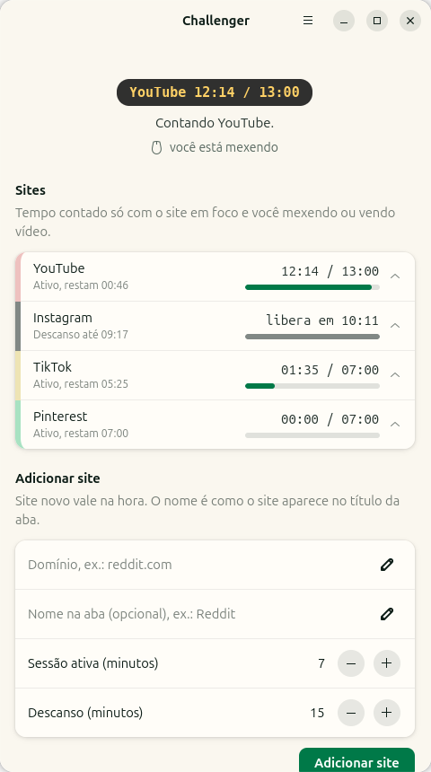
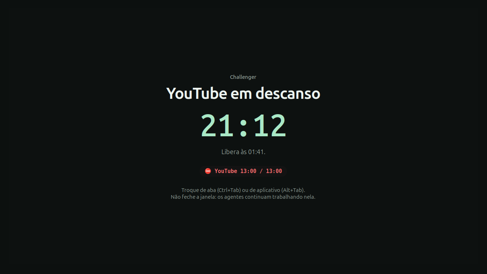

# Challenger

Controle de tempo de sites no Ubuntu que **só conta quando é você olhando**.

Substitui o [Maverick](https://github.com/luiz-nast/maverick) no computador. YouTube, Instagram,
TikTok e Pinterest têm uma sessão de uso; acabou a sessão, o site descansa, com uma tela por cima
do navegador até liberar.



## Por que existe

Agentes de IA agora usam o meu Chrome, pela extensão do Claude, com o mesmo login das minhas
contas. Um controle de tempo comum conta o tempo dos agentes como se fosse meu. O Challenger
olha pela câmera, no próprio computador, para saber se tem gente na frente da tela.

E nunca atrapalha os agentes: não fecha aba, não fecha o navegador, não recarrega página, não
muda URL e não mexe no perfil nem nas extensões do navegador.

## Como conta o tempo

A cada segundo, o site ganha 1 s quando as duas coisas são verdade:

1. **A janela em foco é um navegador num site da lista.** Vale para qualquer navegador (Chrome,
   Firefox, Chromium, Brave, Edge, Vivaldi, apps do Chrome). O site sai do título da janela, só
   onde o próprio site põe o nome (`Vídeo - YouTube`, `(3) Instagram`, `#fyp | TikTok`,
   `Pin em ... | Pinterest`) ou do endereço que o navegador mostra enquanto a aba carrega
   (`m.youtube.com/...`, `youtu.be/...`, `br.pinterest.com/...`). Subdomínios contam.
2. **A câmera diz que é humano olhando:**

| Situação da câmera | Conta tempo? | Por quê |
|---|---|---|
| Rosto detectado | **sim** | é você vendo |
| Câmera tapada, imagem escura ou quase uniforme | **sim** | tentativa de burlar |
| Câmera desligada, ocupada, sem OpenCV ou com erro | **sim** | falha fechada |
| Sala vazia (imagem normal, sem rosto) | **não** | é agente trabalhando sozinho |

- O estado da câmera só muda depois de **3 leituras seguidas iguais** (1 por segundo): uma
  piscada do detector não troca nada. Até a primeira decisão, conta.
- A câmera **só liga** quando um site da lista, liberado, está em foco, e desliga 10 s depois.
  A luz da câmera acesa nessa hora é o Challenger.
- Tela bloqueada não conta.

## Regras

Cada site tem uma **sessão ativa** (tempo contado) e um **descanso** (pelo relógio, com ou sem
você no computador). Acabou a sessão, o site descansa; acabou o descanso, volta com o contador
zerado.

| Site | Domínios | Sessão ativa | Descanso |
|---|---|---|---|
| YouTube | `youtube.com`, `youtu.be`, `m.youtube.com` | 20 min | 4 h |
| Instagram | `instagram.com` | 7 min | 15 min |
| TikTok | `tiktok.com` | 7 min | 15 min |
| Pinterest | `pinterest.com`, `br.pinterest.com`, `pin.it` | 7 min | 15 min |

As regras padrão estão em [`challenger/default_rules.json`](challenger/default_rules.json).

**Mudar regra:**

| O que | Quando vale |
|---|---|
| Adicionar um site novo | na hora (só endurece) |
| Mudar sessão ou descanso de um site, para mais ou para menos | na virada do dia (meia-noite) |
| Remover um site | na virada do dia |

Até a meia-noite a regra antiga continua valendo, e a janela mostra que há mudança para amanhã,
com um botão para desfazer. O tempo contado e o descanso em andamento sobrevivem a reiniciar o
app e o computador: o fim do descanso é guardado como hora marcada.

## Bloqueio

Com um site em descanso em foco, uma tela cobre o navegador em todos os monitores, com o site, o
tempo até liberar, a hora que libera e a pílula de tempo.



- Some no segundo seguinte quando você troca de aba (Ctrl+Tab) ou de aplicativo (Alt+Tab).
- Clique e Esc não fecham. A tela não pega o foco do teclado; por isso a troca de aba funciona.
- Fica por cima até de navegador em tela cheia.
- O navegador continua rodando por trás, intocado: os agentes seguem trabalhando.

## A pílula

A mesma pílula do Maverick, mesmo visual e mesmo comportamento: canto superior direito, com
`Site usado / sessão`, verde contando, amarela no último minuto, cinza quando a sala está vazia
(não conta). Fica 2 s depois que o site sai de foco.


## Privacidade

- Nenhuma imagem da câmera é gravada em disco nem sai do computador. Cada quadro é analisado na
  memória e descartado. A detecção de rosto é local (OpenCV, modelo YuNet de 227 KB).
- Dados de uso e regras pessoais ficam em `~/.config/challenger/config.json` e
  `~/.local/share/challenger/state.json`, fora do repositório.
- O repositório tem só o código, as regras padrão e o modelo de rosto.

## Instalar e rodar

Ubuntu com GNOME (testado no Ubuntu 26.04, GNOME 50, Wayland). Não precisa de sudo.

```bash
git clone https://github.com/luiz-nast/challenger ~/challenger
```

```bash
~/challenger/install.sh
```

O instalador:

1. Usa o Python do sistema com PyGObject e GTK. Se o sistema não tiver OpenCV, cria um venv em
   `~/.local/share/challenger/venv` e instala `opencv-python-headless` nele.
2. Cria o comando `~/.local/bin/challenger`, o atalho **Challenger** no menu e o ícone.
3. Instala a extensão do GNOME `challenger@luiz-nast.github.io`, que diz qual janela está em
   foco. No Wayland, só o GNOME sabe isso. Ela liga no próximo login; até lá o Challenger usa a
   extensão do Maverick, se estiver instalada.
4. Instala e liga o serviço `challenger.service` (systemd do usuário), que **inicia sozinho com a
   sessão**.

Comandos:

| Comando | O que faz |
|---|---|
| `challenger` | abre a janela |
| `challenger status` | mostra sessão, descanso e pendências no terminal |
| `challenger check` | mostra a janela em foco, o site e 4 leituras da câmera |
| `systemctl --user status challenger` | estado do serviço |
| `journalctl --user -u challenger -f` | log ao vivo |
| `./install.sh --remove` | desinstala (seus dados ficam) |

Opções da câmera em `~/.config/challenger/config.json`, chave `camera`: `dark_mean` (brilho médio
abaixo do qual é "tapada", padrão 35), `dark_std` (variação abaixo da qual é "tapada", padrão
10), `smoothing` (leituras iguais para mudar, padrão 3), `face_score` (confiança mínima do rosto,
padrão 0.6).

## Testes

```bash
/usr/bin/python3 -m pytest tests
```

```bash
CHALLENGER_REAL=1 ~/.local/share/challenger/venv/bin/python -m pytest -v tests/integration
```

Os de lógica usam relógio falso, câmera falsa e foco falso. Os de integração (tela desbloqueada)
usam a câmera real, a extensão do GNOME real, a tela de descanso real e um Chrome e um Firefox
de teste, com perfil temporário, abrindo páginas locais.

## Limites conhecidos

- Quem tem acesso à conta pode parar o serviço, editar os arquivos ou mudar o relógio. O objetivo é
  atrito, não uma tranca.
- Quarto escuro com agente trabalhando sozinho conta (imagem escura = "tapada", como manda a regra).
- Rosto muito de lado ou fora do quadro pode virar "sala vazia".
- O som de um vídeo em descanso continua por baixo da tela: pausar mexeria na página do agente.
- O site é reconhecido pelo título da janela. Se um site mudar o formato do título, ajuste em
  `challenger/engine.py` (há testes com os títulos de hoje).

Decisões e motivos: [DECISOES.md](DECISOES.md). Plano: [docs/PLANO.md](docs/PLANO.md).
Aprendizado do Maverick: [docs/aprendizado-maverick.md](docs/aprendizado-maverick.md).

Licença MIT. O modelo de rosto YuNet é do [OpenCV Zoo](https://github.com/opencv/opencv_zoo),
licença MIT ([`challenger/face_detection_yunet.LICENSE`](challenger/face_detection_yunet.LICENSE)).
